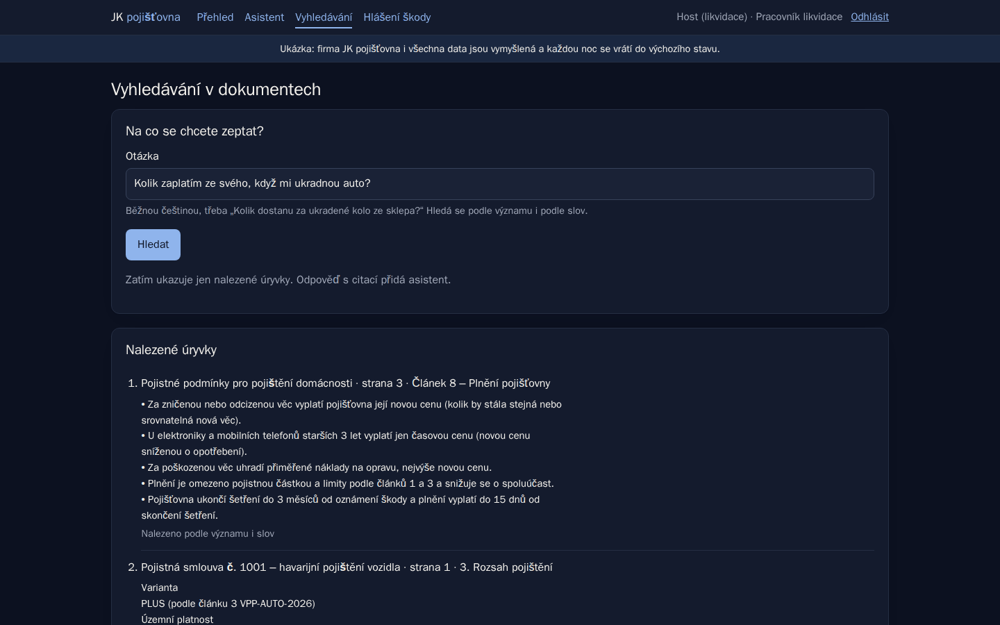
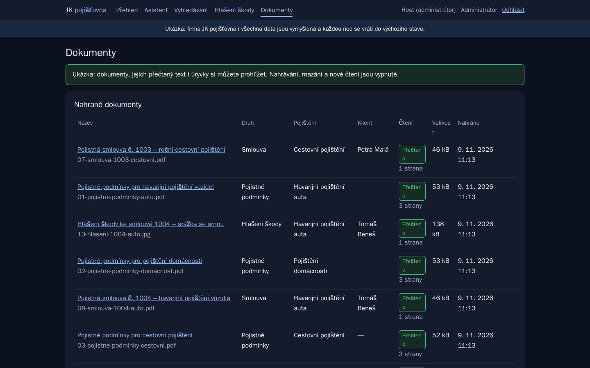
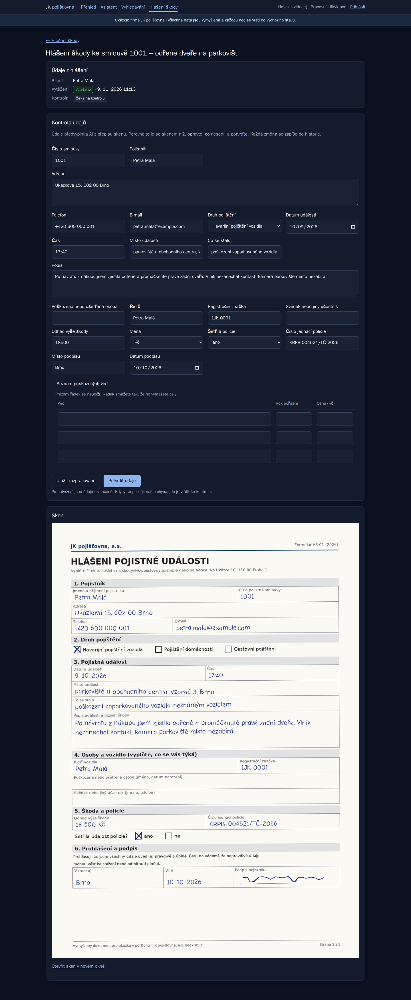
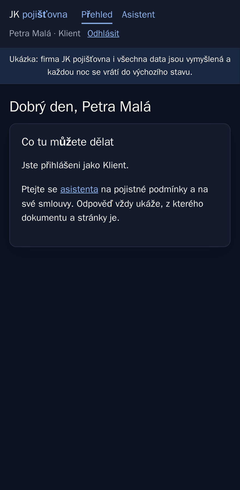

# Document assistant — cited answers instead of searching PDFs

[Česky](README.md)

An assistant for a made-up insurer, **JK pojišťovna, a.s.** Clients and
claims staff ask about policy terms and contracts in plain language and get
an answer **citing the document and page**. When the documents do not
contain the answer, the assistant says “I don't know”. AI extracts data
from scanned claim forms into a form that a person reviews and confirms.

It is a portfolio demo; all documents and data are made up. The app and
the documents are in Czech.

**Try it:** _live demo link coming soon_ — on the sign-in page, just click
“Vyzkoušet jako Klient / Pracovník likvidace / Administrátor” (client /
claims handler / administrator).

## Screenshots

| Document search                          | Documents (administrator)               |
| ---------------------------------------- | --------------------------------------- |
|        |  |

| Reviewing extracted data next to the scan              | Client on a phone                                    |
| ------------------------------------------------------ | ---------------------------------------------------- |
|       |  |

_The screenshots come from the test environment, where a stand-in answers
instead of the AI (it filled in the form data). Screenshots from the live
demo will follow._

## What it does

- **Three roles:** client (only their own contracts), claims handler (all
  documents and claims), administrator (document management).
- **Document upload** (PDFs and scans), checked by the actual file content,
  not the extension.
- **Reading text from PDFs and scans.** Claude Haiku reads a scan once, on
  upload. The text is split into passages with the page number and the
  article heading.
- **Search by meaning and by words at the same time.** The embedding model
  runs inside the app for free; passages live in Postgres (pgvector).
- **Cited answers:** the answer cites a specific passage, document and
  page. No citation = “I don't know”. Daily limits are enforced by the
  server.
- **Claim extraction:** from the scan transcript, AI fills in 22 fields in
  a fixed structure. The claims handler corrects and confirms them in
  a form next to the scan. Every change is logged (who, when, the old and
  the new value).
- **Quality measurement:** a set of 35 questions with correct answers and
  citations, automatic evaluation of both search and answers.
- **Demo mode:** one-click sign-in, the administrator can only look, a
  per-visitor question limit, data resets every night.

## Interesting decisions

- **Permissions already in the search.** The assistant only gets passages
  from documents the user may see. It does not rely on the model “not
  revealing” anything: a client never finds another client's contract, so
  it never reaches the AI. Measured: 0 of 6 attempts.
- **Citations instead of trust.** Every answer shows where it comes from;
  outside the documents the assistant says “I don't know”.
- **Measured, not guessed.** For 27 questions answered in the documents,
  the right page is among the top five passages for 25 (93%). Searching
  only by meaning or only by words found fewer, which is why the app uses
  both and also uses a contract number from the question. Measurement-driven
  tuning raised the hit count from 23 to 25. Where search fails is described in the
  [evaluation](docs/evaluace.md), with ideas for improvement.
- **The person confirms, the AI suggests.** The AI's suggestion is never
  overwritten; human corrections are stored separately. That makes it
  possible to measure the AI's accuracy even after review. Two people
  cannot overwrite each other's work with simultaneous edits.
- **E-mails and phone numbers never reach the AI** — they are replaced with
  a placeholder before sending. A test against the AI stand-in checks it.
- **Cheap to run:** a small model (Claude Haiku), daily limits, each scan
  read once, the embedding model inside the app, evaluation via batch
  processing at half price. Estimated $3–8 per month.

## Technology

| Part                              | What and why                                                    |
| --------------------------------- | --------------------------------------------------------------- |
| Python, FastAPI, Jinja2           | pages rendered on the server, one small script for dialogs      |
| Claude API (Haiku)                | cited answers, reading scans, extraction in a fixed structure   |
| PostgreSQL 18 + pgvector          | documents, passages and search by meaning                       |
| SQLAlchemy 2.1, Alembic, Pydantic | database, migrations, validation of data from the AI            |
| Argon2                            | password hashes                                                 |
| pytest + Playwright (Python)      | browser tests, including phone layout                           |
| Docker Compose                    | development and tests run the same on every machine             |

## Running it

```
docker compose up -d
docker compose run --rm web python -m app.prikazy vyvojove-ucty
```

The app runs at http://localhost:8000. The passwords of the three
development accounts (one per role) are random and are written to
`data/ucty-vyvoj.txt` — there is no password in the code. Without the
`ANTHROPIC_API_KEY` key everything works except the assistant's answers
and reading scans.

## Tests

```
docker compose --profile test run --rm e2e
```

**109 tests** with their own database and server; account passwords are
generated for every run. A stand-in answers instead of Anthropic, so
nothing leaves the machine and the test can see what would have been sent
to the AI. They mainly guard permissions (a client cannot reach another
client's contract, not even through the assistant), forged files, limits,
personal data and the phone layout. The same suite runs on GitHub Actions.

Evaluation without AI (free):

```
docker compose run --rm web python -m app.prikazy evaluace --zprava docs/evaluace-vysledky.md
```

## How it was made

**The code was written by AI — Claude Code from Anthropic — in dialogue
with me.** I do not hide it, because this is exactly what I offer: taking
a real application all the way with AI so that it is secure, tested and
maintainable.

My role (Jakub Košťan): the brief and the phase plan, decisions on
permissions (who may see what), on what may be sent to the AI, on limits
and running costs, approving every plan before work and checking the
result.

The assistant was built in five days (Nov 4–8, 2026), step by step with
a plan before the work and a summary after it. Every step got tests, and
only after the whole suite passed was it reported as done.
