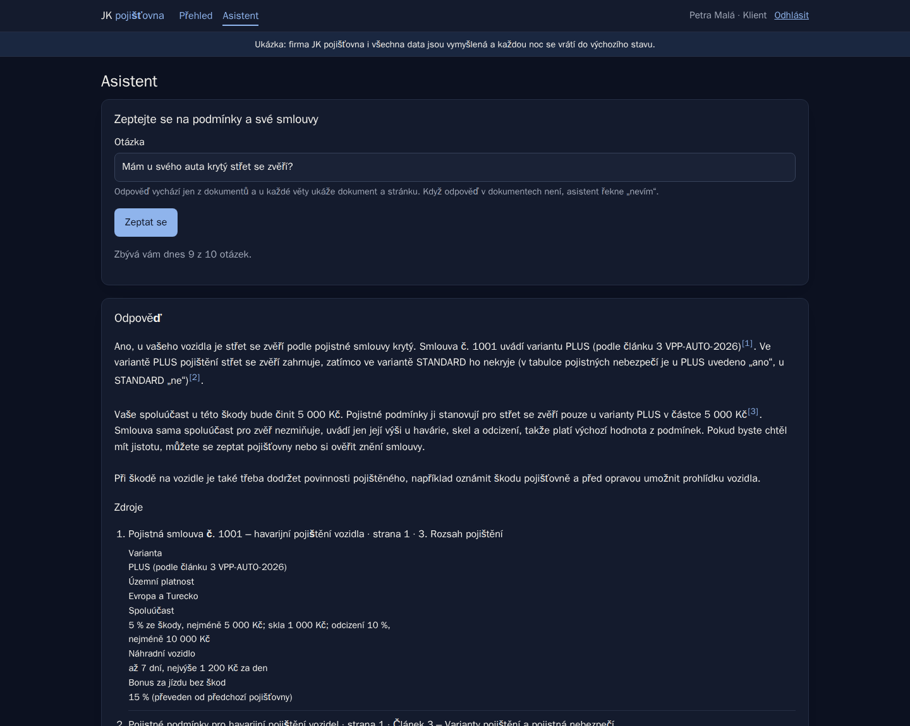
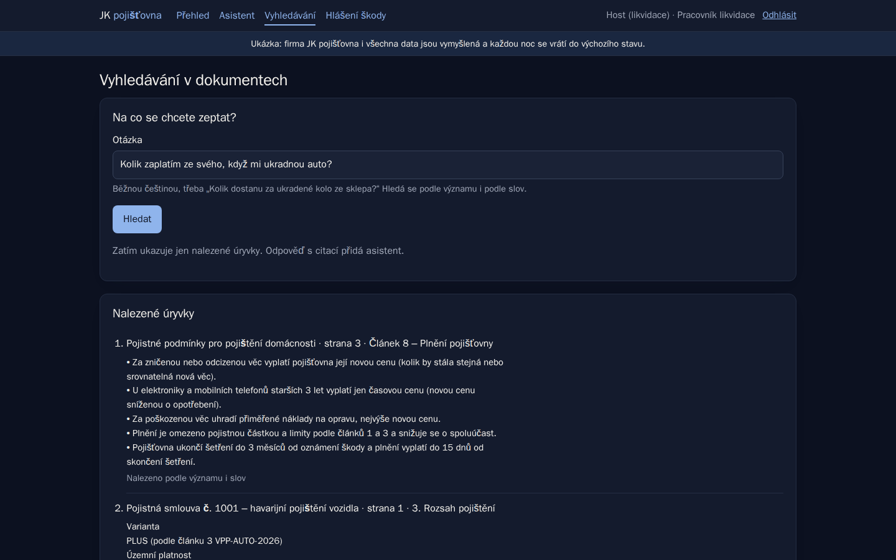
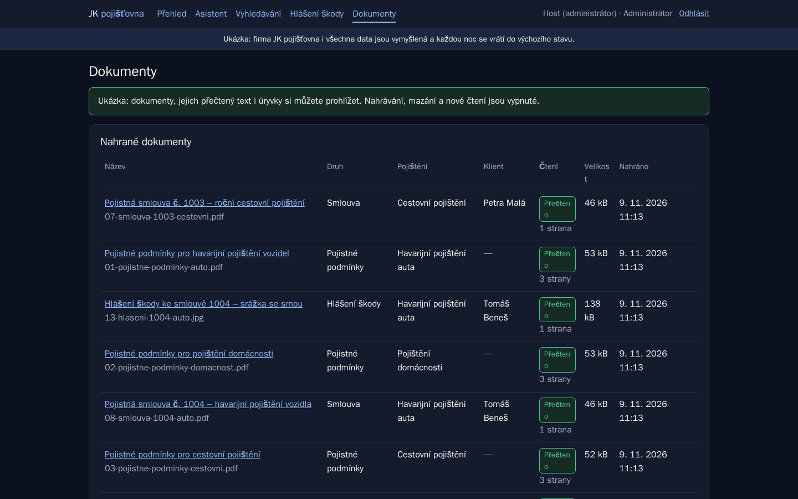
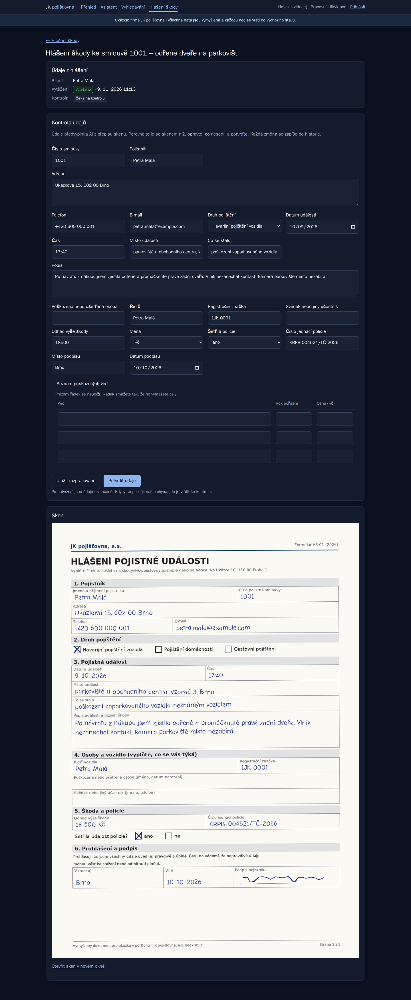
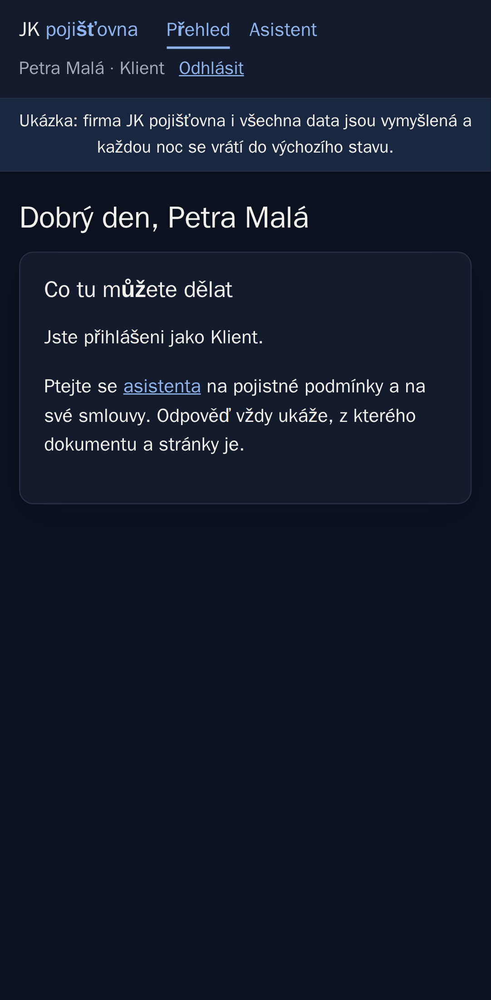

# Asistent nad dokumenty — odpovědi s citací místo hledání v PDF

[English](README.en.md)

Asistent pro vymyšlenou pojišťovnu **JK pojišťovna, a.s.** Klient
i pracovník likvidace se ptají běžnou češtinou na pojistné podmínky
a smlouvy a dostanou odpověď **s citací dokumentu a stránky**. Když odpověď
v dokumentech není, asistent řekne „nevím“. Z naskenovaných hlášení škody
AI vytěží údaje do formuláře, který člověk zkontroluje a potvrdí.

Je to ukázka do portfolia, všechny dokumenty a údaje jsou vymyšlené.

**Vyzkoušejte si to:** _odkaz na živou ukázku doplním_ — na přihlašovací
stránce stačí kliknout na „Vyzkoušet jako Klient / Pracovník likvidace /
Administrátor“.

## Snímky



_Skutečná odpověď modelu Claude Haiku na ukázkových datech: klientka se
ptá na „své auto“ a asistent odpoví podle její smlouvy, ne jen obecně
podle podmínek._

| Vyhledávání v dokumentech              | Dokumenty (Administrátor)              |
| -------------------------------------- | -------------------------------------- |
|  |  |

| Kontrola vytěžených údajů vedle skenu             | Klient v telefonu                                |
| ------------------------------------------------- | ------------------------------------------------ |
|  |  |

_Snímky pod odpovědí jsou z testovacího prostředí, kde místo AI odpovídá
napodobenina (údaje ve formuláři vyplnila ona)._

## Co umí

- **Tři role:** klient (jen své smlouvy), pracovník likvidace (všechny
  dokumenty a hlášení), administrátor (správa dokumentů).
- **Nahrávání dokumentů** (PDF i skeny) s kontrolou skutečného obsahu
  souboru, ne přípony.
- **Čtení textu z PDF i ze skenů.** Sken přečte Claude Haiku jen jednou při
  nahrání. Text se rozdělí na úryvky s číslem stránky a nadpisem článku.
- **Vyhledávání podle významu i podle slov zároveň.** Vyhledávací model
  běží přímo v aplikaci zdarma, úryvky leží v Postgresu (pgvector).
- **Otázky s citací:** odpověď cituje konkrétní úryvek, dokument a stránku.
  Odpověď bez citace = „nevím“. Denní limity hlídá server.
- **Vytěžení hlášení škody:** AI z přepisu skenu vyplní 22 údajů v pevném
  tvaru. Pracovník likvidace je ve formuláři vedle skenu opraví a potvrdí.
  Každá změna jde do historie (kdo, kdy, původní a nová hodnota).
- **Měření kvality:** sada 35 otázek se správnými odpověďmi a citacemi,
  automatické vyhodnocení vyhledávání i odpovědí.
- **Ukázkový režim:** přihlášení jedním klikem, administrátor jen
  prohlíží, limit otázek na návštěvníka, data se každou noc obnoví.

## Zajímavá rozhodnutí

- **Oprávnění už ve vyhledávání.** Asistent dostane jen úryvky
  z dokumentů, které smí uživatel vidět. Nespoléhá se na to, že model
  „nebude prozrazovat“: cizí smlouvu klient nenajde, takže k AI vůbec
  neodejde. Měřeno: 0 ze 6 pokusů.
- **Citace místo důvěry.** Každá odpověď ukazuje, odkud je; mimo
  dokumenty asistent odpoví „nevím“.
- **Měřeno, ne odhadnuto.** Na 27 otázkách s odpovědí v dokumentech je
  správná stránka mezi prvními pěti úryvky u 25 (93 %). Hledání jen podle
  významu nebo jen podle slov našlo méně, proto aplikace hledá oběma
  způsoby a navíc využije číslo smlouvy z otázky. Úprava podle měření
  zvedla počet trefených otázek z 23 na 25. Kde hledání chybuje, je v [evaluaci](docs/evaluace.md) popsané
  i s náměty na zlepšení.
- **Odpovědi změřené naostro.** Ze 35 otázek odpověděl asistent správně
  (správný údaj i citace správné stránky) u 32–34 (91–97 %) ve čtyřech
  bězích; model mezi běhy kolísá. „Nevím“ u otázek mimo dokumenty 5 z 5,
  cizí smlouva neodešla ani jednou. Jeden běh stojí asi 0,04 $. Otázka,
  která padá pořád, míří do tabulky, kterou čtení PDF rozsype do řádků
  — další krok je lepší čtení tabulek.
- **Opravy podle měření, ne podle dojmu.** Postupně z 22 na 32–34 z 35:
  - model přemýšlel i s vypnutým přemýšlením a odpověď se uřízla
    (22 → 28);
  - zákazník píše „ukradnou auto“, podmínky „odcizení vozidla“: malý
    model teď otázku před hledáním převede do slov dokumentů (zlomek
    haléře za otázku; když AI nejde, hledá se jako dřív);
  - snímek skutečné odpovědi odhalil, že na „mám u svého auta…“ hledání
    nenašlo smlouvu klientky — teď k nalezeným přidá její smlouvu;
  - u tří otázek bylo přísné samo měření (čekalo „6 týdnů“, asistent
    napsal „šest týdnů“) — opravené a u každé je v sadě napsané proč.
- **Vytěžení hlášení škody:** na pěti ukázkových skenech AI
  vyplnila správně 110 ze 110 údajů. Měření odhalilo i chybu, kterou
  napodobenina v testech schovala: skutečné API odmítlo příliš složité
  schéma odpovědi.
- **Člověk potvrzuje, AI navrhuje.** Návrh od AI se nikdy nepřepisuje,
  opravy člověka se ukládají zvlášť. Díky tomu jde měřit přesnost AI i po
  kontrole. Dva lidé si souběžnou opravou nepřepíšou práci.
- **E-maily a telefony k AI neodcházejí** — před odesláním se nahradí
  značkou. Hlídá to test proti napodobenině AI.
- **Levný provoz:** malý model (Claude Haiku), denní limity, čtení skenu
  jen jednou, vyhledávací model v aplikaci, měření hromadnou dávkou za
  poloviční cenu. Odhad 3–8 $ měsíčně.

## Technologie

| Část                                   | Co a proč                                                     |
| -------------------------------------- | ------------------------------------------------------------- |
| Python, FastAPI, Jinja2                | stránky skládá server, jediný malý skript na potvrzovací okna |
| Claude API (Haiku)                     | odpovědi s citacemi, čtení skenů, vytěžení v pevném tvaru     |
| PostgreSQL 18 + pgvector               | dokumenty, úryvky a vyhledávání podle významu                 |
| SQLAlchemy 2.1, Alembic, Pydantic      | databáze, migrace, kontrola dat od AI                         |
| Argon2                                 | otisky hesel                                                  |
| pytest + Playwright (Python)           | testy v prohlížeči, i rozložení na telefonu                   |
| Docker Compose                         | vývoj i testy běží stejně na každém počítači                  |

## Spuštění

```
docker compose up -d
docker compose run --rm web python -m app.prikazy vyvojove-ucty
```

Aplikace běží na http://localhost:8000. Hesla tří vývojových účtů
(jeden za každou roli) jsou náhodná a zapíšou se do `data/ucty-vyvoj.txt`
— v kódu žádné heslo není. Bez klíče `ANTHROPIC_API_KEY` funguje všechno
kromě odpovědí asistenta a čtení skenů.

## Testy

```
docker compose --profile test run --rm e2e
```

**110 testů** s vlastní databází a serverem; hesla účtů se vymyslí při
každém běhu. Místo Anthropicu odpovídá napodobenina, takže nic neodchází
ven a test zjistí, co by k AI odešlo. Hlídají hlavně oprávnění (klient se
k cizí smlouvě nedostane ani přes asistenta), podvržené soubory, limity,
osobní údaje a rozložení na telefonu. Stejná sada běží na GitHub Actions.

Evaluace bez AI (zdarma):

```
docker compose run --rm web python -m app.prikazy evaluace --zprava docs/evaluace-vysledky.md
```

## Jak vznikal

**Kód napsala AI — Claude Code od Anthropicu — v rozhovoru se mnou.**
Neskrývám to, protože právě tohle nabízím: dotáhnout s AI skutečnou
aplikaci tak, aby byla bezpečná, otestovaná a udržovatelná.

Moje role (Jakub Košťan): zadání a plán fází, rozhodnutí o oprávněních
(kdo co smí vidět), o tom, co smí odejít k AI, o limitech a nákladech,
schválení každého plánu před prací a kontrola výsledku.

Asistent vznikl za pět dní (4.–8. 11. 2026) po krocích s plánem před prací
a souhrnem po ní. Každý krok dostal testy a prošla celá sada, teprve pak
se ohlásil jako hotový.
